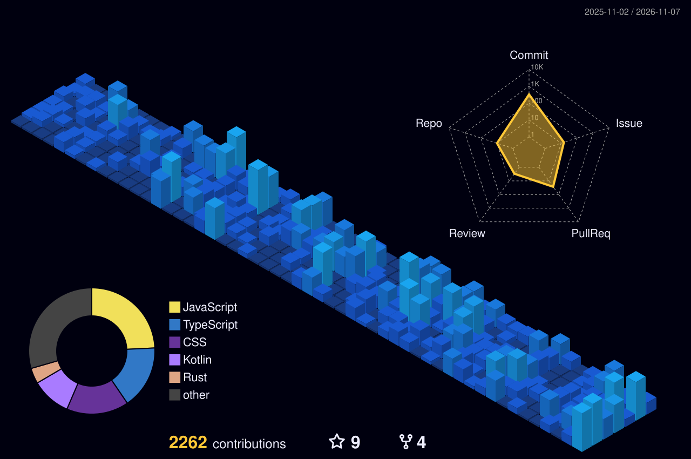

<div align="center">

[](https://git.io/typing-svg)


</div>

```console
bima@cloud-engineer:~$ whoami
> Bima Adam

bima@cloud-engineer:~$ cat bima.ts
const bima = {
  target     : "Cloud Engineer (in transition)",
  focus      : ["AWS", "GCP", "Azure", "Infrastructure as Code"],
  currently  : "Fullstack Engineer",
  background : "3+ years Fullstack (TypeScript, NestJS, Next.js, React)",
};

bima@cloud-engineer:~$ echo $STATUS
> Open to Remote / WFH 🌏

bima@cloud-engineer:~$ git log --oneline --all | tail -1
> "still learning. still building."
```



<div align="center">


</div>

### ~/stack

<table>
  <tr><td><sub>CLOUD</sub></td><td></td></tr>
  <tr><td><sub>DEVOPS</sub></td><td></td></tr>
  <tr><td><sub>LANGUAGES</sub></td><td></td></tr>
  <tr><td><sub>FRAMEWORKS</sub></td><td></td></tr>
  <tr><td><sub>MOBILE</sub></td><td></td></tr>
</table>

### ~/github

[](https://github.com/bimaadam?tab=followers)
[](https://github.com/bimaadam)
[](https://github.com/bimaadam?tab=repositories)

<br/>


